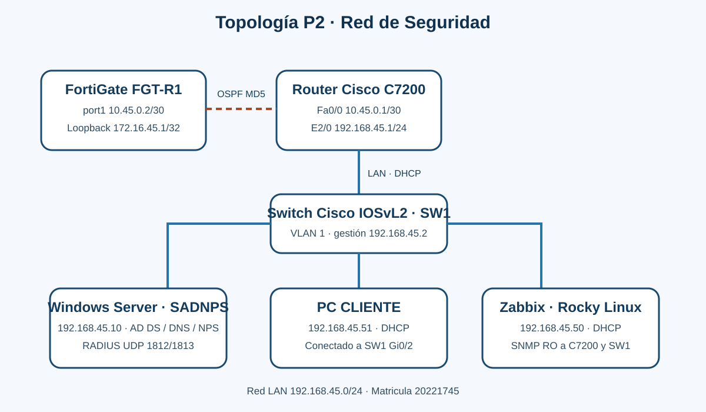
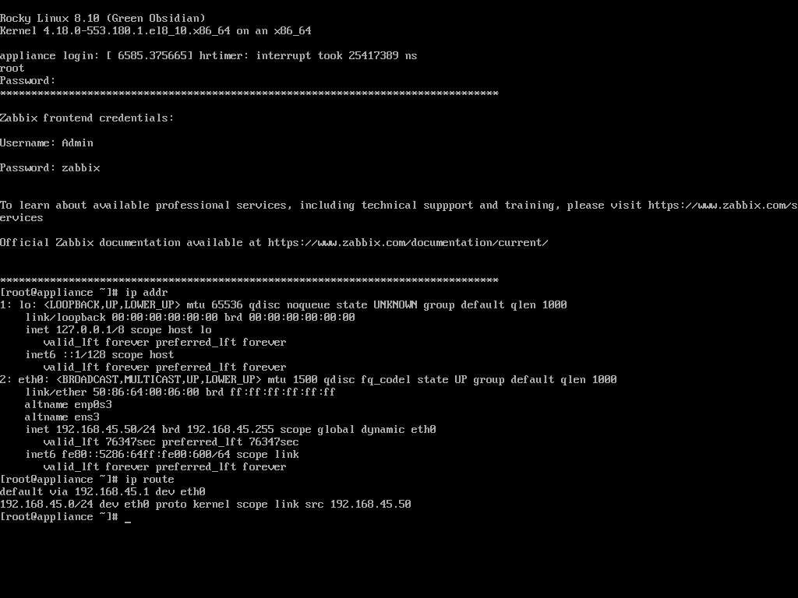
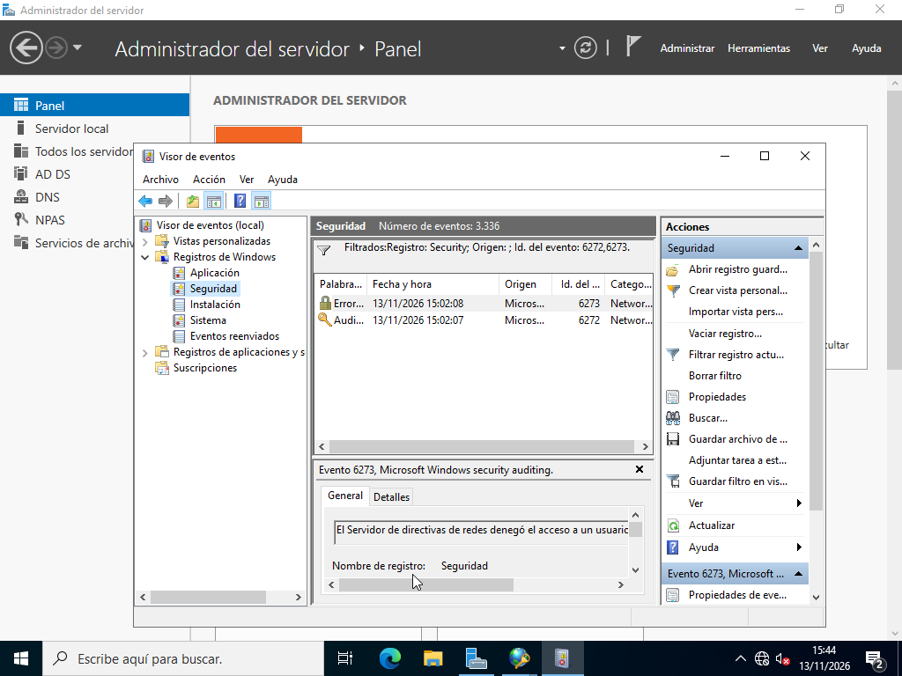
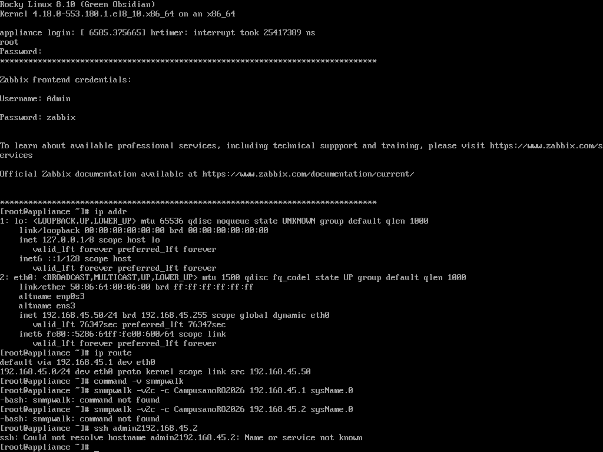
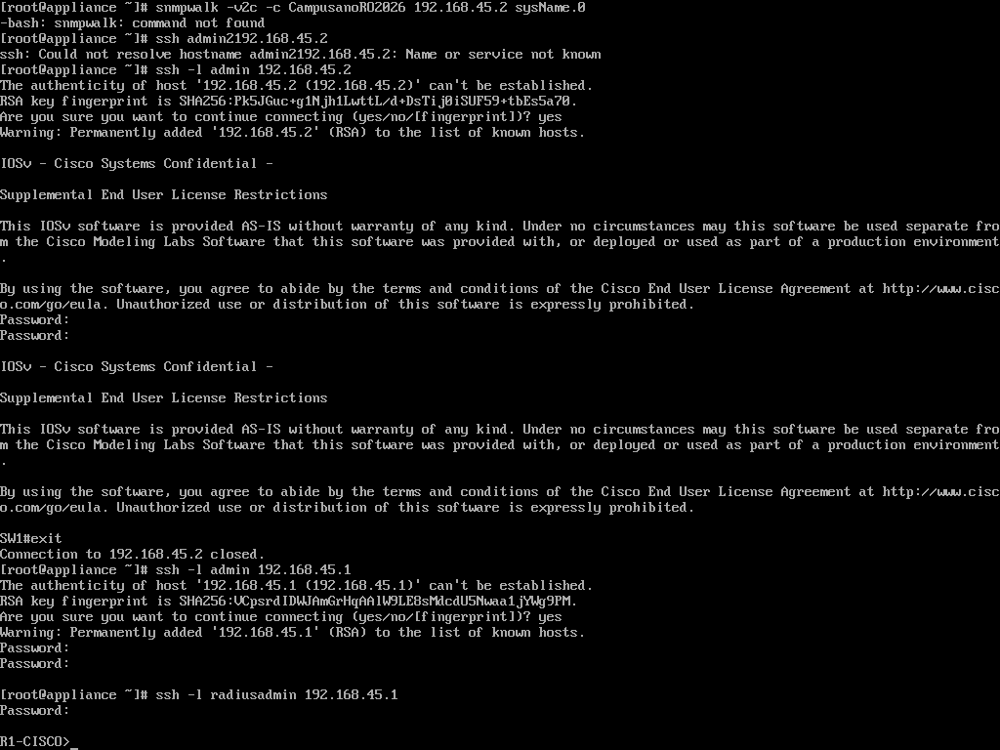

# P2 · Seguridad de Redes — Starlin Campusano

## Video demostrativo

[Ver demostración en YouTube (máximo 10 minutos)](https://www.youtube.com/watch?v=PfekN2Y-nu0)

## Propósito del laboratorio

Implementar y verificar una infraestructura de red segmentada con acceso administrativo seguro, direccionamiento basado en la matrícula `20221745`, DHCP en el router, OSPF con autenticación MD5, autenticación RADIUS/NPS, monitoreo SNMP de solo lectura y análisis CIS de controles seleccionados en Cisco IOS.

## Topología



Archivo importable en PNET: [Segundo_Parcial.unl](Segundo_Parcial.unl). La topología contiene solo los nodos existentes: C7200, FortiGate, SW1, Windows Server/NPS, Zabbix y PC CLIENTE.

### Direccionamiento

| Equipo | Interfaz / función | Dirección |
|---|---|---:|
| C7200 | LAN / gateway / DHCP | `192.168.45.1/24` |
| SW1 | Gestión VLAN 1 | `192.168.45.2/24` |
| SADNPS | AD DS, DNS y NPS | `192.168.45.10/24` |
| Zabbix | Cliente DHCP | `192.168.45.50/24` |
| PC CLIENTE | Cliente DHCP | `192.168.45.51/24` |
| C7200 ↔ FortiGate | Tránsito OSPF | `10.45.0.0/30` |
| FortiGate | Loopback anunciada | `172.16.45.1/32` |



## Implementación y validación

- DHCP en C7200; el router reportó concesiones para `.50` y `.51`.
- OSPF MD5 entre C7200 y FortiGate; ambos extremos mostraron vecino `FULL` y rutas aprendidas.
- Administración de Router y Switch por SSH; VTY no acepta Telnet.
- RADIUS del C7200 apunta a Windows NPS (`192.168.45.10`). Se probó una autenticación aceptada y otra rechazada.
- Los eventos NPS `6272` y `6273` se verificaron en el registro Security.
- Zabbix obtuvo `.50` por DHCP y recibió valores SNMP de `R1-CISCO` y `SW1`.
- Desde SW1 hubo respuesta 3/3 al router, Windows Server y Zabbix.







## Análisis CIS y hardening

El propósito del análisis fue detectar controles seleccionados de CIS Benchmark alineados a Cisco IOS antes y después del hardening. El estado inicial fue `2/18`; el análisis final completo dio `18/18`. Los criterios, motivos, resultados y comando para reproducirlo están en [docs/CIS-hardening.md](docs/CIS-hardening.md).

Las recomendaciones aplicadas incluyen SSHv2 solamente, secretos locales cifrados, ACL de administración, registro de accesos exitosos/fallidos, buffer syslog, servicios HTTP desactivados, SNMP de solo lectura limitado por ACL, OSPF autenticado y desactivación de source routing.

## Archivos

- `configs/`: captura del running-config Cisco C7200; configuraciones documentadas del switch y extracto de FortiGate reconstruidos desde los comandos aplicados y comprobaciones guardadas; material de Windows NPS y Zabbix. Las claves se redactaron. La VM está apagada, por lo que esos dos archivos no se presentan como exportaciones actuales.
- `docs/`: propósito, recomendaciones CIS, pruebas y resultados.
- `evidencias/`: resultados CIS, validación de OSPF/conectividad y SNMP.
- `images/`: diagrama y capturas de evidencia.
- `scripts/audit_cis_ios.py`: auditor de controles seleccionados, solo lectura.
- `Segundo_Parcial.unl`: topología de PNET.
- `StarlinCampusano_20221745_P2.txt`: enlaces de repositorio y video para entregar.

## Reproducir la auditoría

```bash
python3 scripts/audit_cis_ios.py configs/C7200-running-config.txt
```

Las contraseñas, claves OSPF y comunidad SNMP se omiten en los artefactos públicos; no son necesarias para reproducir la evaluación de presencia de los controles.
